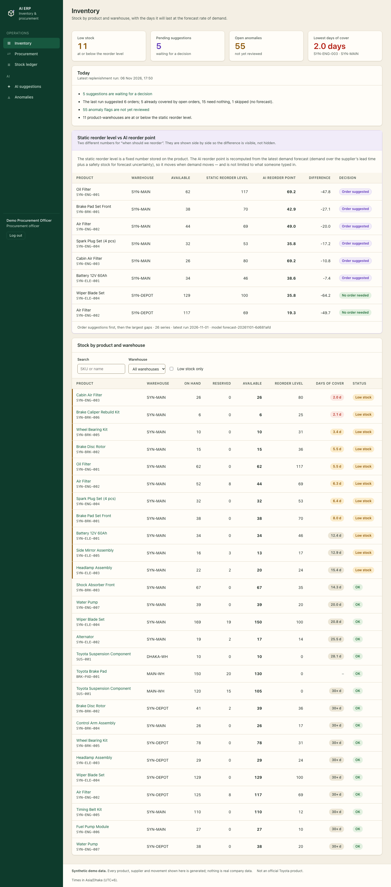
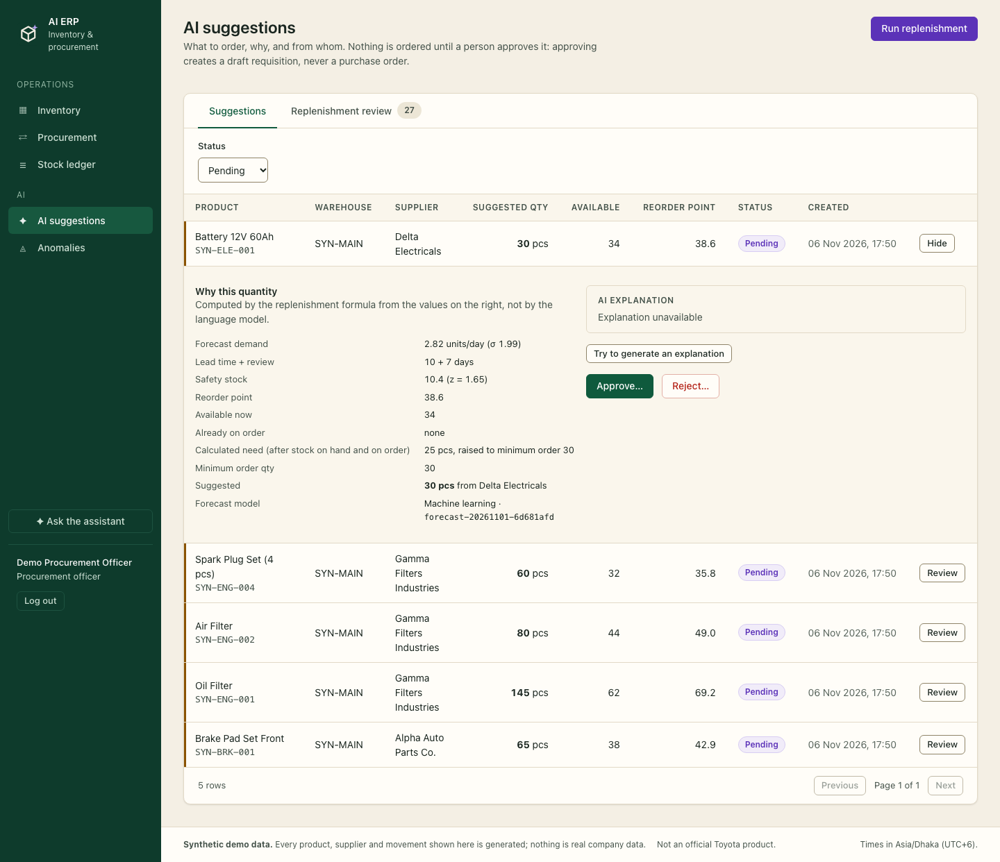

# AI ERP for an auto-parts business (synthetic demo)

An ERP for inventory and procurement with an **AI core**: it forecasts demand, suggests what to order, flags unusual
stock movements and answers questions about the data. A person approves every purchase. Everything runs on
**generated demo data** (products, suppliers, stock movements); nothing is real company data.

> This is a personal project and **not an official Toyota product**. The name is only the business context of the demo.

| | |
|---|---|
|  |  |
| Inventory with days of cover, and the static reorder level next to the AI's | A suggestion: every input, the model version, an explanation labelled as AI-written |

## Live demo

* App (client): https://toyota-ai-erp-iun9.vercel.app
* ERP API health: https://toyota-ai-erp.vercel.app/health
* AI service health: https://toyota-ai-service.onrender.com/health (free tier: sleeps when idle, the first request takes about 1 minute)
* Source: https://github.com/isfak1537/toyota-ai-erp

Hosting: the client and the ERP API run on Vercel, the AI service on Render, and the database is Postgres on Neon.
Groq is optional and only used to write explanations and answer assistant questions; the numbers never come from it.

Login: the demo accounts are created by the seed (`npm run seed:users`). Their credentials are not published here; ask the author.

## What it does

* **Inventory and ledger.** Stock per product and warehouse, atomic stock changes (no overselling under concurrent
  requests), a ledger row with the balance after every movement and the user who made it.
* **Procurement.** Requisition → purchase order → goods receipt, each step a person's action; a requisition can be
  entered by hand or created from an AI suggestion; goods default to the warehouse the order is destined for.
* **Forecasting.** Daily demand per product and warehouse: a moving average and a gradient-boosting model, compared on
  14 days neither had seen. The page shows both errors, including where the model is *not* better.
* **Replenishment.** Safety stock, reorder point and order quantity from the forecast, the supplier's lead time and
  minimum order, and what is already on order. A "replenishment review" lists **every** series and why it was or was not
  ordered. Approving a suggestion creates a **draft** requisition, atomically and only once.
* **Anomalies.** Five written rules (confirmed rule hits) and a statistical model that ranks the ten riskiest movements
  of each week (review queue). They are shown apart, each with a plain-language reason.
* **Assistant and explanations.** A language model writes short explanations from the computed facts and answers
  questions through read-only tools. If it fails, is switched off or runs out of quota, every feature still works.
* **Roles.** Administrator, warehouse manager, procurement officer, viewer; enforced by the API, mirrored in the UI.
  An AI audit log (administrator) records runs, decisions and every language-model call.

## How the AI is built, and the rules it follows

1. **The AI never writes business records.** The AI service reads the database through a **read-only role**. Only the
   endpoint `POST /ai/suggestions/:id/approve`, called by an authorised person, creates a record (a draft requisition).
2. **Numbers come from code and models; the language model only writes words.** It is given computed facts and told to
   quote them; it cannot do arithmetic that ends up in a record.
3. **A failure never breaks a feature.** AI service down: AI pages show a banner, ERP pages keep working. Language
   model down: the explanation says "unavailable".
4. **Everything is traceable.** Each suggestion stores all its inputs and the model version; every decision and model
   call goes to the audit log.
5. **Metrics are reported honestly,** including when the model does not beat the baseline (below).

## Results, honestly

All of this is measured on **synthetic data** (24 product-warehouse series, 90 days, one seed). It shows the pipeline
works and how the methods compare here. It says little about the accuracy a real plant would see.

**Forecast** (mean absolute error in units per day, last 14 days held out; full report in
[`ai-service/REPORT.md`](ai-service/REPORT.md)):

| Method | MAE |
|---|---|
| Moving average (baseline) | 1.536 |
| Gradient-boosting model (the policy for series with at least 28 days of history) | **1.317** (14% lower; better on 18 of 24 series) |
| "Pick the better model per series" on the same 14 days | 1.294, but optimistic: it chooses on the days it is scored on |
| The same rule, chosen on an earlier window (honest) | 1.414, *worse* than always using the model |

So the rule "choose per series" was dropped in favour of "use the model once there are 28 days of history".

**Anomalies** (8 injected anomalies with known labels, used only to evaluate): the rules catch 7 and the weekly queue 6,
together 8, but the price is workload and precision: 147 flags (before this pass: 33), **combined precision 0.054**. Most
of the recall gain comes from excluding receipts that are linked to a purchase document, which also makes the model blind
to a *wrong* receipt that has a document. The rules catch the injected anomalies largely by construction, because the
injections were designed with the same ideas. Thresholds were deliberately not tuned on 8 labels.

**One more finding.** The demo products seeded to sit "near their reorder point" use a static reorder level about 1.5x the
AI's reorder point, because the AI uses recent average demand. So the AI correctly suggests nothing for them. The
dashboard shows both numbers side by side; `npm run demo:prepare` stages stock so a live demo has suggestions.

## Architecture

```
client/ (React) ──► server/ (Express, Prisma, PostgreSQL) ──► ai-service/ (FastAPI, scikit-learn)
                         │                                          │ read-only DB role
                         └──► Groq / Gemini / Ollama (LLM)          ▼
                                                              the same PostgreSQL
```

Details, the project tree and the request paths are in [`docs/architecture.md`](docs/architecture.md).

## Run it locally

Needs Node 24 (developed on 24.12), PostgreSQL, and Python 3.13 (from python.org or pyenv; see `ai-service/README.md`).
Each step starts from the repository root.

**1. Database and API**

```bash
cd server
cp .env.example .env              # fill in DATABASE_URL, JWT_SECRET, AI_SERVICE_SECRET, DEMO_*_PASSWORD (never commit .env)
npm install
npm exec prisma -- migrate deploy
npm run seed:synthetic -- --apply # synthetic demo data (a dry run without --apply)
npm run seed:users                # the four demo users
npm run dev                       # http://localhost:5001
```

**2. AI service** (needs the read-only role: `ai-service/sql/create_ai_readonly_role.sql`)

```bash
cd ai-service
/path/to/python3.13 -m venv .venv && .venv/bin/pip install -r requirements-dev.txt
cp .env.example .env              # AI_DB_URL, AI_SERVICE_SECRET (the same as the API's)
.venv/bin/uvicorn app.main:app --port 8000
```

**3. Client**

```bash
cd client
npm install && npm run dev        # http://localhost:5173
```

Log in as an administrator, open **AI models → Retrain**, then **AI suggestions → Run replenishment**.
For a live demo with several suggestions: `cd server && npm run demo:prepare -- --apply` (undo with `npm run demo:undo -- --apply`).

Demo accounts (passwords are the `DEMO_*_PASSWORD` values you set): `admin@demo.synthetic`, `procurement@demo.synthetic`,
`warehouse@demo.synthetic`, `viewer@demo.synthetic`.

## Tests

| What | Command | Needs |
|---|---|---|
| API (units, integration, concurrency, 401/403 matrix) | `cd server && npm test` | a separate `*_test` database (`TEST_DATABASE_URL`) |
| AI service (features, models, rules, API, DEMO rows, notebooks) | `cd ai-service && .venv/bin/pytest` | nothing (fixtures); `-m db` for the read-only role |
| Client (pages, roles, states) | `cd client && npm test` | nothing (mocked API) |
| Real stack: smoke + accessibility | `cd client && npm run e2e` | all three services running |

Reconcile the stock ledger with the inventory at any time: `cd server && npm run reconcile`.

## Documentation

* [`docs/demo-script.md`](docs/demo-script.md): the 10-minute demonstration, click by click
* [`docs/architecture.md`](docs/architecture.md): tree, data flow, failure behaviour, security
* [`docs/deployment.md`](docs/deployment.md): hosting, every environment variable, Neon, Vercel, Render
* [`docs/release-checklist.md`](docs/release-checklist.md): the steps only the owner can do
* [`docs/`](docs): PRD, SRS (requirement IDs used in commits), build plan
* [`ai-service/README.md`](ai-service/README.md), [`ai-service/REPORT.md`](ai-service/REPORT.md), `CLAUDE.md` (working rules)

## Limitations

* **Synthetic data only.** Forecast and anomaly numbers say nothing about real data; the demand is generated, the
  injected anomalies were designed with the same ideas as the rules.
* **Small scale.** 24 series and 90 days: a single 14-day holdout is a noisy estimate for each series.
* **Demand is observed issues.** Stock-outs hide demand (censoring); the synthetic data has few.
* **Minimal authentication.** JWT, four roles; no refresh tokens, no user-management screen, login limits kept in memory
  per process.
* **Free tiers.** The hosted setup cold-starts, throttles, and keeps some limits per instance (see `docs/deployment.md`).
* **The language model can be wrong or unavailable.** It never changes data, and its output is always labelled.
* **Single currency and no tax model** beyond what the SRS lists; sales, manufacturing and finance modules are future work.

## Project status

| Phase | Content | Tag |
|---|---|---|
| P0 | Stable core: atomic stock, typed errors, validation, test harness | `m1-stable-core` |
| P1 | Deterministic synthetic data, reconcile, labels | `m2-seed` |
| P2-P3 | AI service: forecasting, anomaly detection, evaluation | `m3-ai-models` |
| P4-P5 | Auth, replenishment, approval, anomalies, LLM, assistant | `m4-ai-erp` |
| P6 | React UI | `i7-ui` |
| P7 | Release preparation: demo staging, deployment, documentation | `i8-release` |
